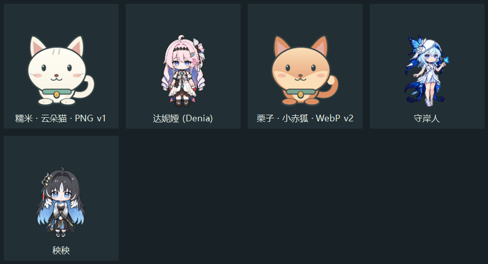

# PocketPet · 桌面陪伴宠物

一个用 C++17 / Win32 编写的 Windows 10/11 桌面小伙伴。原生透明窗口，无浏览器运行时，无需联网。

拖起来甩一下，落地会弹跳；工作时可以在旁边张望、思考、小憩。支持自由选择动作形态和导入 Codex v1/v2 宠物包。

[下载 Windows 便携版](https://github.com/LovelyCates/PocketPet/releases/latest) · [添加宠物](ADDING_PETS.md) · [素材来源](PETS_SOURCES.md) · [验证说明](docs/VALIDATION.md)



## 打开就能玩

下载并解压便携包，运行 `PocketPet.exe`；从源码构建时运行 `out/PocketPet.exe`。所有角色形象都从 EXE 同级的 `pets` 文件夹读取，EXE 不包含内置宠物或角色绘制代码。图标会出现在系统托盘中。移动程序时，请把 `pets` 一起移动。

公开版包含两只原创示例，以及达妮娅、守岸人、秧秧三个独立角色包；各自的来源和许可说明位于对应文件夹。更多角色通过下方下载脚本添加。

```text
PocketPet.exe
pets/
  cloud-cat-v1/
    pet.json
    spritesheet.png
  fox-v2/
    pet.json
    spritesheet.webp
```

添加、替换角色素材不需要重新编译 EXE。把新角色文件夹放进 `pets`，右键 → 换个伙伴 → 刷新角色列表，再选择角色。修改当前角色的图片后重新选择该角色即可重新读取。如果 `pets` 中没有可用角色，程序会提示放入角色包，不显示任何内置备用形象。

| 操作 | 效果 |
| --- | --- |
| 单击身体 | 摸摸、挥手回应 |
| 双击身体 | 跳一下 |
| 拖住身体后松手 | 拎起、甩出去、重力下落、碰撞回弹 |
| 鼠标滚轮 | 缩放宠物 |
| 右键身体或托盘图标 | 角色切换、大小、散步、安静模式等 |
| 把角色文件拖到身体上 | 加载新角色，保留位置和速度 |
| 单击托盘图标 | 找回隐藏的宠物 |

默认开启「自动陪伴」：在待机、张望检查、专注思考、打招呼之间低频切换；开启「偶尔散步」后还会左右走动。约 90 秒没有互动会养神，小憩 18–32 秒后自己醒来，再进入下一轮陪伴。摸摸或拖动会打断养神和自动动作。安静模式减少动画并暂停自主活动与气泡。可在陪伴设置中开启全屏应用自动隐藏。窗口透明部分不会遮挡正常鼠标操作。

右键 → **动作与形态** 可以自由选择角色素材中的九组动作：发呆、右走、左走、挥手、跳跃、失落、等待、思考、检查。手动选择的待机、挥手、失落、等待、思考、检查会持续保持并循环，不会被自动行为或养神打断；选「恢复自动形态切换」即可交回自动陪伴。左右走与跳跃按短暂动作播放。摸摸、跳跃等互动结束后会回到已选形态。手动「养神 / 小憩」会持续到你摸摸或拖动它。

不同外观取决于素材：例如达妮娅角色包把正常形态与工作形态画在不同动作行里。程序播放这些已有动作，不会凭空生成另一套衣服或姿势。v2 额外提供 16 个注视方向。没有专门睡眠动作的角色，养神时会放慢待机；如包中定义 `sleeping` 动画则使用该动作。

如果素材轮廓有绿色抠图残留，右键 → 陪伴设置 → **清理当前角色的绿色杂边**。这是每只角色单独保存的显示净化开关，默认关闭；只处理轮廓附近的绿色污染，不改 PNG/WebP 原文件。角色清单也可设置 `"cleanGreenEdges": true` 作为默认值。真正的绿色角色应保持关闭。

设置保存在 `%LOCALAPPDATA%/PocketPet/settings.json`，退出再开会记住角色、大小、位置与行为偏好。角色选择保存为相对于 EXE 的路径，因此整个程序文件夹移动后仍能找到角色。启动时加 `--portable` 则把设置也保存在 EXE 旁边。不创建开机启动项，不安装服务。

## 增补角色与分组

附带下载清单可补充以下 16 个社区角色，右键 → 换个伙伴后按作品选择：

- 宝可梦：皮卡丘、伊布、耿鬼、卡比兽、小火龙、谜拟丘。
- 原神：芙宁娜、胡桃、甘雨、神里绫华、可莉、雷电将军。
- 鸣潮：菲比、赞妮、守岸人、秧秧。原有达妮娅可继续使用。

公开版自带 5 个角色；安装全部补充角色后可选择 19 个（其中守岸人和秧秧已包含，下载脚本会跳过）。全部仍是 EXE 同级 `pets` 中的独立文件夹。`pet.json` 中的可选 `collection` 字段指定菜单分组。

发布包附带 `community-pets.json` 和 `install-community-pets.ps1`。受个人使用或整包再分发条款限制的社区图集，直接从原作者固定版本下载到本机，不镜像到本仓库；下载时保留来源与许可。可在 EXE 目录用 PowerShell 7 运行：

```powershell
.\install-community-pets.ps1
```

也可以仅下载选定角色：`.\install-community-pets.ps1 -Ids pokemon-pikachu,genshin-furina,wuwa-shorekeeper`。安装只读取 JSON、图片与许可文本，逐文件检查固定 SHA-256，不运行远端脚本；同名已有角色不覆盖。安装后刷新角色菜单即可。详见 `PETS_SOURCES.md`。动作丰富程度由原图集决定，不代表每只角色都有服装变化或进化形态。

## 导入现有角色

简明操作、自动识别范围和自定义图集示例见 `ADDING_PETS.md`；EXE 旁附有可复制的 `pet-template.json`。

可导入角色目录、`pet.json`、PNG 或 WebP 精灵图。右键 → 换个伙伴 → 导入角色包，或拖到宠物身上。外部角色包会验证后复制到 EXE 同级的 `pets`，原文件不变，同名角色不会被覆盖。角色菜单只扫描同级 `pets`。

Codex 角色也一样：把角色文件夹复制进 `pets`，或者选择原有的 `pet.json` 导入即可。从旧版升级时，上次选择的外部角色会自动复制进本地 `pets`，后续使用本地副本。

支持以下固定布局：

- Codex v1：1536 × 1872，8 列 × 9 行，单帧 192 × 208。
- Codex v2：1536 × 2288，8 列 × 11 行，额外 16 个鼠标注视方向。
- 自定义布局：在清单中填写 `frame` 对象，并可填写 `animations`。

基本清单：

```json
{
  "id": "my-pet",
  "displayName": "我的伙伴",
  "description": "在旁边陪你工作",
  "spriteVersionNumber": 2,
  "spritesheetPath": "spritesheet.webp"
}
```

动画行依次为 idle、running-right、running-left、waving、jumping、failed、waiting、running、review。有效帧数依次为 6、8、8、4、5、8、6、6、6。v2 最后两行为顺时针 16 个注视方向，第一格为向上。

自定义动画示例（使用格子的零起始编号）：

```json
{
  "displayName": "自定义角色",
  "spritesheetPath": "sheet.png",
  "frame": {"width": 192, "height": 208, "columns": 8, "rows": 9},
  "animations": {
    "idle": {"frames": [0,1,2,3,4,5], "fps": 4, "loop": true},
    "waving": {"frames": [24,25,26,27], "fps": 8, "loop": false, "fallback": "idle"}
  }
}
```

程序根据待机帧的可见范围建立共享脚底锚点，切换时保持脚底位置。文件损坏、尺寸不匹配或动作无效时保留当前角色。角色图集需要本身包含合适动作，程序不会自动生成缺失的美术。

附带两份原创示例角色包：`pets/cloud-cat-v1`（PNG）和 `pets/fox-v2`（WebP）。构建时原样复制到 `out/pets`，不编入 EXE。示例素材生成代码独立放在 `tools/sample_art.cpp`，仅测试工具使用。它们不包含 Codex 内置角色素材。暂不支持 ZIP 直接导入，请先解压。

## 构建与验证

需要 PowerShell 7、Visual Studio 2022 Build Tools，安装「使用 C++ 的桌面开发」及 Windows SDK。构建脚本通过 vswhere 查找工具，不需要将 cl 加入 PATH。

```powershell
.\build.ps1 -Test
```

第三方源码已随仓库提供，构建时不下载依赖。使用静态 C/C++ 运行库。只将 libwebp 解码所需代码链接进桌面程序；测试工具另链接编码器并在 `build/fixtures` 生成测试素材，不修改实际角色文件。

```powershell
# 生成透明预览图
.\out\PocketPet.exe --preview F:\path\preview.png
# 直接打开指定角色
.\out\PocketPet.exe --pet F:\path\pet.json
# 使用独立测试设置，记录操作与物理状态，指定秒数后退出
.\out\PocketPet.exe --settings F:\path\test-settings.json --diagnostics F:\path\events.jsonl --exit-after 30
```

独立设置实例用于测试，避免影响日常宠物。测试时可加 `--inspectable` 临时将窗口放入任务栏，方便 UI 测试工具发现；普通运行只在托盘显示。普通运行使用单实例，重复打开会找回宠物；传入角色则通知原实例切换。

源文件：`src/core.h` 是物理和动作时序，`assets.cpp` 是包解析、导入复制与图片读取，`render.cpp` 仅播放外部精灵图，`main.cpp` 是 Windows 窗口与交互。

## 当前边界

这是独立娱乐程序；没有接入 Codex 的任务状态、聊天或语音。没有桌面窗口攀爬、跨屏抛物线桥接和多宠物同时运行。多屏按宠物所在显示器工作区处理边界，屏幕配置变化后将位置收回可见区域。主程序体积与角色素材体积分别计算。
